# Architecture

## Assumptions

Settled in this contract so the map can be planned. The stack choices came from the architecture question round: numbered scripts, TOML config, a versioned asthma file drop, and a JSONL checkpoint compacted to Parquet.

- Python 3.11, a virtualenv, `requirements.txt`, and pytest. Shared code lives in `lib/` and is imported with `PYTHONPATH` set to the repository root. Scripts do not take CLI arguments. Every knob is in `config/pipeline.toml`, which no script rewrites.
- The store is the filesystem. There is no database server and no web UI.
- Spatial assignment uses the unsimplified WGS84 shapefile `UHF_42_DOHMH_2009/UHF_42_DOHMH_2009_WGS84.shp` from [nycehs/NYC_geography](https://github.com/nycehs/NYC_geography). The simplified `UHF42.geo.json` in that repository is used only as a figure basemap.
- The first geography download resolves `master` to a commit SHA, writes `data/raw/geography/SOURCE.txt`, and later runs reuse those files.
- Traffic timestamps are America/New_York civil time. A source field that indicates UTC stops the pipeline.
- A location is eligible only when it has at least `min_observation_dates` distinct local dates and at least `min_complete_hours` complete hours. Both thresholds apply together.
- For a pooled asthma period, the neighborhood exposure is the unweighted mean of that neighborhood's year-level means. The neighborhood must be eligible in every constituent year (`pool.require_all_years = true`).
- Automated counts and historical counts may be used for different periods only when the comparability check in `select-sources` passes. That check uses traffic versus traffic, with Pearson r at least `sources.mix_min_traffic_r` (0.8) and at least `min_uhf_per_period` overlapping neighborhoods. It does not read asthma rates. AADT never shares a series with another source.
- The primary exposure is the observed-hour mean defined under Data model. The hour-of-day balanced mean is a sensitivity measure.
- Sample maps are static, one file per period.
- Pearson confidence intervals come from `scipy.stats.pearsonr(...).confidence_interval` (SciPy >= 1.12). Holm adjustment is coded with NumPy inside `lib/stats.py`. Alpha stays 0.05 and is not a sensitivity knob.
- Unusually high 15-minute counts (above the within-year 99.9th percentile) are flagged and kept.
- `README.md` is a source file. `results_summary.md` and `interpretation_guide.md` are generated from the result tables.
- Optional paired bootstrap comparisons stay off unless `stats.bootstrap_comparisons` is true.

## Problem and non-goals

The pipeline answers, for New York City's 42 United Hospital Fund neighborhoods: to what extent average hourly vehicular traffic volume is associated with annual asthma emergency-department visit rates among children ages 4 and under. The secondary question is whether the direction and strength of that association are consistent across the asthma periods that fall in 2015–2019 and 2022–2023.

H₀: the population Pearson correlation ρ between neighborhood mean hourly traffic volume and the asthma ED rate is 0. H₁ predicts a positive correlation. The primary test is a two-sided Pearson correlation at α = 0.05. The sign of r is reported separately. The unit of analysis is the UHF42 neighborhood. n is the number of neighborhoods in a test.

The pipeline will not claim that traffic causes asthma visits, will not compare results to background literature inside `results_summary.md`, will not analyze 2020 or 2021, will not split a multi-year asthma estimate into annual outcomes, will not impute missing asthma or traffic values as zero, will not mix AADT with automated or historical counts in one correlation series, will not choose the primary period by the smallest p-value, and will not change coverage thresholds after seeing a p-value.

## Stack

- Client: the researcher's terminal.
- Server: local Python 3.11 scripts. There is no network server.
- Database: files under `data/` and `outputs/`.
- Config: `config/pipeline.toml`, read with the standard-library `tomllib`.
- Libraries: pandas, NumPy, requests, GeoPandas, Shapely, pyproj, SciPy, Matplotlib, Seaborn, openpyxl, pyarrow. Minimum versions are pinned in `requirements.txt`: pandas>=2.2, numpy>=1.26, requests>=2.32, geopandas>=1.0, shapely>=2.0, pyproj>=3.6, scipy>=1.12, matplotlib>=3.8, seaborn>=0.13, openpyxl>=3.1, pyarrow>=15, pytest>=8.0.
- Tests and dev commands, from the repository root:

```
python3.11 -m venv .venv
. .venv/bin/activate
pip install -r requirements.txt
export PYTHONPATH=.
pytest
./run_all.sh
python scripts/01_audit_sources.py
```

`./run_all.sh` is a caller, not an operation. It exports `PYTHONPATH=.`, runs `scripts/01` through `scripts/10` in order, and stops at the first non-zero exit.

## Runtime

The terminal starts one script at a time. Each script loads `config/pipeline.toml`, calls `lib/`, and writes files. Third parties are the Socrata APIs for automated counts (`7ym2-wayt`), historical counts (`btm5-ppia`), and AADT (`6amx-2pbv`), plus the GitHub geography repository on the first boundary download. LION, when a boundary case needs it, is a local file path, not an API.

Layout the scripts call:

- `lib/config.py` — `load_config`
- `lib/socrata.py` — `fetch_schema`, `fetch_year_counts`, `paginate`
- `lib/audit.py` — `inventory_asthma`, `score_coverage`, `select_source`
- `lib/clean_asthma.py` — `clean_asthma`
- `lib/clean_traffic.py` — `clean_traffic`
- `lib/geo.py` — `ensure_boundaries`, `assign_points`, `resolve_non_interior`
- `lib/aggregate.py` — `complete_hours`, `location_years`, `segment_years`, `neighborhood_periods`
- `lib/merge.py` — `merge_uhf_period`
- `lib/describe.py` — `descriptive_tables`
- `lib/stats.py` — `pearson_by_period`, `spearman_by_period`, `sensitivity`, `compare_periods`
- `lib/plots.py` — `sample_figures`, `result_figures`
- `lib/report.py` — `workbook`, `narratives`, `compile_exclusions`
- `scripts/01_audit_sources.py` through `scripts/10_report.py`
- `run_all.sh`, `tests/`, `tests/fixtures/`

The system map is the flowchart in the next section that has a route trace. It is drawn from the traces below.

## Route traces

An operation is one script invocation or one `pytest` invocation. Scripts share no trace.

### audit-sources

caller: Terminal, the command that starts the audit.
request: `python scripts/01_audit_sources.py`. Arguments: none. The process reads these config fields: `api.app_token` (str, optional), `api.timeout_seconds` (int), `api.max_retries` (int), `api.user_agent` (str), `api.automated.base_url` (str), `api.historical.base_url` (str), `api.aadt.base_url` (str), `years.targets` (list of int), `years.excluded` (list of int), `asthma.raw_dir` (str), `fields.automated` / `fields.historical` / `fields.aadt` (tables of canonical name → list of str aliases), `borough_aliases` (table of str → list of str).
handler: `load_config`. `inventory_asthma` requires exactly one `.csv` or `.xlsx` in `asthma.raw_dir`, records the original `TimePeriod` labels, and classifies each label with the period rule in Data model. `fetch_schema` requests `$limit=1` from each of the three APIs and writes the live JSON keys. `fetch_year_counts` requests `count(*)` with `$where` for each target year, plus one grouped year list per API. The year field is the first configured year alias present in the live keys. `fields.aadt.year` includes `aadt_year`, and a text sample is quoted. When no year alias is present and that source's first configured date alias is present, the `$where` and the grouped query both use `date_extract_y` on that alias, with the target year unquoted. `fields.historical.date` is `date`. Automated and AADT have no date alias. `schema_ok` is true for either resolution. A source with neither a year alias nor a date alias, a missing asthma file, or more than one asthma file stops the script. No traffic volumes are paged. No year column is written onto a traffic extract.
stages: Terminal, Python, Config, AsthmaExport, Socrata, Outputs, Terminal.
response: `status` str (`ok`, `empty`, or `error`), `exit_code` int (0, 2, or 1), `message` str, and `outputs/audit/schema_snapshot.json`, `outputs/audit/asthma_time_periods.csv` (table `asthma_time_periods`), `outputs/audit/traffic_year_counts.csv` (table `traffic_year_counts`).
screen: On success the terminal prints the period labels, each label's kind (`year` or `pooled`), and the year counts for the three traffic APIs. On an empty export (headers present, zero rows) it prints that the export has no rows and exits 2. On a missing or ambiguous export, a source with neither a year alias nor a date alias, or a failed count query, it prints the path or the live column names and exits 2. On a network or parse failure it prints the URL and exits 1.
diagram:

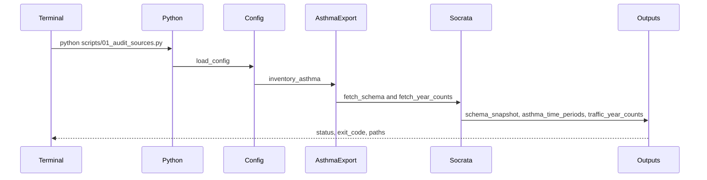

### select-sources

caller: Terminal, the command that starts source selection.
request: `python scripts/02_select_sources.py`. Arguments: none. Reads the audit files plus config `api.*` pagination fields (`page_size` int, `order_field` str, `retry_backoff_seconds` float), `thresholds.*` (ints), `sources.preference` (list of str), `sources.mix_min_traffic_r` (float), `sources.aadt_xy_csv` (str), `geography.*`, `pool.require_all_years` (bool), `years.primary_preference` (int).
handler: `load_config`, then read the audit tables. `ensure_boundaries` downloads the pinned shapefile sidecars and `UHF42.geo.json` when `SOURCE.txt` is absent, and checks out 42 valid polygons. `paginate` then pulls coverage columns (`:id`, year, month, day, hour, minute, volume, segment, wkt, direction, borough, and the AADT value when scoring AADT) one year at a time into `coverage.parquet`, using the checkpoint rules in `download-traffic`. Scoring uses `score_coverage` and the same hour, direction, and threshold rules as aggregation. A historical schema that is already one hour per row is scored as a complete hour. A historical schema that is neither quarter-hours nor one-hour counts is unusable, with reason `hourly_definition_unresolved`. `select_source` applies this order and writes `source_selection.json` without editing the TOML:

1. If automated coverage is adequate for every asthma period, use automated for all of them (scenario A).
2. Otherwise, if automated is adequate for at least one period, keep those periods on automated. Historical may fill only the gaps when the overlap check passes: most recent overlap year, intersection n >= `min_uhf_per_period`, traffic-versus-traffic Pearson r >= `mix_min_traffic_r`, asthma rates unread. A period that both sources cover stays on automated. If the check fails, the gaps are excluded.
3. If automated covers no period, and historical covers at least one, use historical for the periods it covers and do not add automated or AADT.
4. If neither automated nor historical covers a period, score AADT. AADT is usable only when the schema has a point field or `sources.aadt_xy_csv` joins station ids to coordinates. Hourly exposure is AADT/24. AADT does not mix with another source.
5. Every dropped period is written with a reason. If none remain, exit 2.

`order_field` must be `:id`. The coverage extract is an audit artifact. Cleaning does not read it.
stages: Terminal, Python, Config, Outputs, GeographyRepo, GeographyLocal, Socrata, TrafficRaw, Outputs, Terminal.
response: `status` str, `exit_code` int, `message` str, `outputs/audit/source_selection.json` (table `source_selection`), `outputs/dataset_source_comparison.csv` (table `dataset_source_comparison`, matched and usable counts still empty), `outputs/audit/coverage_for_selection.csv` (table `coverage_for_selection`).
screen: On success the terminal prints the scenario, the source for each period, and any excluded period with its reason. When the export's periods produce a selection with zero included periods, it prints scenario D and exits 2. A shapefile that does not have 42 valid unique ids, an unresolved hourly definition, or a failed page exits 2 with the offending year and source. A network failure exits 1.
diagram:

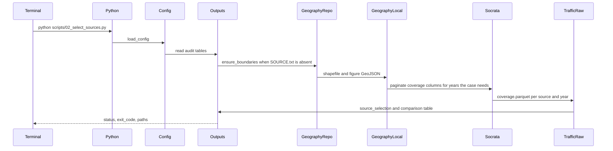

### download-traffic

caller: Terminal, the command that starts the full download.
request: `python scripts/03_download_traffic.py`. Arguments: none. Reads `source_selection.json` and config `api.page_size` (int, default 10000), `api.timeout_seconds` (int), `api.max_retries` (int), `api.retry_backoff_seconds` (float), `api.order_field` (str, required value `:id`), `api.app_token` (str, optional).
handler: For each included period, for each constituent year, for that period's source only, `paginate` does the following. Request `count(*)` with `$where` on the resolved year field, quoting the year when the snapshot says the column is text. Request pages with `$limit` = page size, `$offset` starting at 0, `$order=:id`, and `$select` including `:id` plus the source fields. Append each page to `pages.jsonl` and update `checkpoint.json` with the next offset, the row count, and the page hash. Advance the offset by the number of rows in that page. Resume a later run only when the JSONL line count equals the checkpoint. If they disagree, exit 2 and leave the year folder untouched. Retry HTTP 429 and 5xx with backoff, honoring `Retry-After`. Any other 4xx exits 1. After the last page, require the row count to equal `count(*)`, require a zero count of duplicate `:id`, and require no short page before the count is reached. Then write `records.parquet` and `manifest.json` (row count, min and max `:id`, parquet sha256) and delete `pages.jsonl`. A failed check deletes neither the JSONL nor a partial parquet: it writes no `records.parquet`. The script pages one year file at a time and does not hold every year in memory. It always re-downloads the selected years. It does not promote `coverage.parquet` to the analysis snapshot.
stages: Terminal, Python, Config, Outputs, Socrata, TrafficRaw, Outputs, Terminal.
response: `status` str, `exit_code` int, `message` str, `data/raw/traffic/<source>/year=<YYYY>/records.parquet`, and `manifest.json` beside it. `outputs/audit/download_log.csv` (table `download_log`) has one row per year.
screen: On success the terminal prints, for each year, the expected count and the parquet count. On a count mismatch, duplicate `:id`, or checkpoint mismatch it prints the year, both counts, and exits 2, and that year has no `records.parquet`. On a retry exhaustion or HTTP 4xx it prints the URL and exits 1.
diagram:

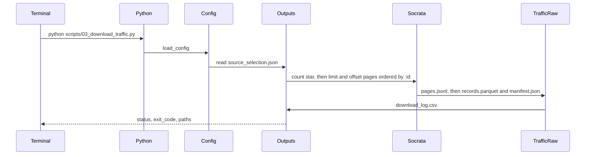

### clean

caller: Terminal, the command that starts cleaning.
request: `python scripts/04_clean.py`. Arguments: none. Reads the asthma export, `records.parquet` for included years, `schema_snapshot.json`, and config `asthma.*`, `thresholds.high_count_percentile` (float, 99.9), `fields.*`, `borough_aliases`.
handler: `clean_asthma` keeps UHF42 rows for the age-4-and-under ED measure, applies the period rule, drops labels whose range includes an excluded year, and refuses to expand a pooled label into yearly rows. It parses the rate and the count as numbers. Tokens that mean suppressed become null, not 0. It standardizes `uhf42_id` to the decimal string of the numeric GeoID with leading zeros removed. `clean_traffic` types the automated-count fields, builds a local timestamp, drops exact duplicate rows while counting them, keeps zero volumes, and excludes negative volumes. Quarter-hours must be a subset of {0, 15, 30, 45}; any other minute set exits 2. Historical rows that are already hourly become one vehicle-per-hour value and are not divided. A historical field that is not a one-hour count exits 2. AADT rows store AADT/24 and a null hour count. High counts are flagged and kept. The script reads one year parquet at a time.
stages: Terminal, Python, Config, AsthmaExport, TrafficRaw, Outputs, Terminal.
response: `status` str, `exit_code` int, `message` str, `outputs/data/cleaned_asthma.csv` (table `cleaned_asthma`), `outputs/data/cleaned_traffic.parquet` (table `cleaned_traffic`), `outputs/cleaning_log.md`, `outputs/audit/exclusions_clean.csv` (table `exclusions`).
screen: On success the terminal prints asthma row counts by period, duplicate rows removed, and invalid counts flagged. When the asthma filter leaves zero rows, it prints that and exits 2. Duplicate neighborhood-period asthma rows, an unmapped direction code, or an unexpected minute set exit 2 and name the key. A missing `records.parquet` for a selected year exits 2.
diagram:

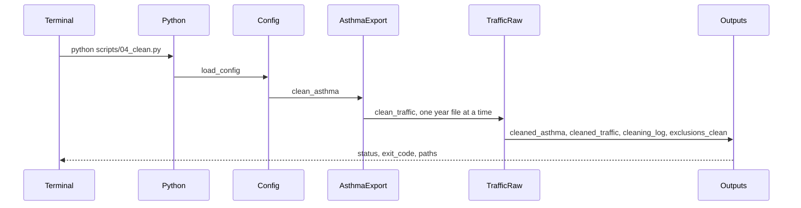

### assign-uhf

caller: Terminal, the command that starts the spatial assignment.
request: `python scripts/05_assign_uhf42.py`. Arguments: none. Reads cleaned traffic, the local shapefile, optional `geography.id_crosswalk_csv` (str), optional `geography.lion_path` (str), `geography.boundary_tolerance_meters` (float, 1), `geography.coordinate_round_meters` (float, 1), and `borough_aliases`.
handler: `assign_points` builds one point per distinct monitoring location from the WKT, not one point per volume row. It accepts a location as EPSG:4326 when sample coordinates fall in longitude -74.3 to -73.6 and latitude 40.4 to 40.95, or as EPSG:2263 when they fall in New York State Plane range. Any other range exits 2. Points and polygons are reprojected to EPSG:2263 before `geopandas.sjoin` with predicate `within`. The boundary id column is the first of `UHFCODE`, `uhfcode`, `UHF_CODE`, `GeoID`, `geoid` whose normalized values equal the asthma `uhf42_id` set. If none do, the crosswalk CSV is required. `monitoring_location_id` is the SHA-1 of `segment_id`, rounded projected x, and rounded projected y. Interior points take the containing polygon. A point in no polygon is `outside_nyc`. A point within the tolerance of a boundary, or assigned to more than one polygon, is `boundary`. A traffic borough that disagrees with the polygon borough is `borough_mismatch`. Those three classes are excluded from the primary data unless `lion_path` is set, in which case `resolve_non_interior` assigns the point to the UHF containing the majority of the LION segment length, breaks ties by exclusion, and never emits two UHF rows for one location. A missing shapefile exits 2 and tells the person to run `select-sources`. This script does not contact GitHub.
stages: Terminal, Python, Config, Outputs, GeographyLocal, LION, Outputs, Terminal. An interior-only run uses GeographyLocal, Outputs, Terminal in place of LION.
response: `status` str, `exit_code` int, `message` str, `outputs/data/traffic_monitoring_locations.geojson` (table `monitoring_locations`), `outputs/data/traffic_with_uhf42.parquet` (table `traffic_with_uhf42`), `outputs/quality/spatial_join_audit.csv` (table `spatial_join_audit`), `outputs/audit/exclusions_geo.csv`.
screen: On success the terminal prints locations assigned, unmatched, on a boundary, and borough-mismatched. When every point is interior, the LION file is not read. When any point is outside, on a boundary, or borough-mismatched and `lion_path` is empty, it prints those counts and exits 2. An id column that does not match asthma ids, with no crosswalk, exits 2. An unrecognized coordinate range exits 2.
diagram:

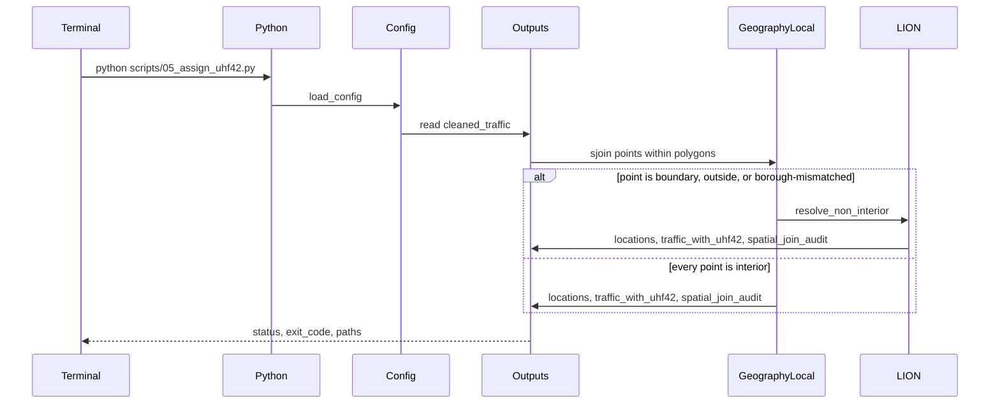

### aggregate-traffic

caller: Terminal, the command that starts aggregation.
request: `python scripts/06_aggregate_traffic.py`. Arguments: none. Reads `traffic_with_uhf42.parquet`, `source_selection.json`, and config `thresholds.min_observation_dates`, `thresholds.min_complete_hours`, `thresholds.min_segments_per_uhf`, `pool.require_all_years`.
handler: `complete_hours` sums the four quarter-hour volumes for a key of monitoring location, local date, local hour, direction, and session. The session is `requestid` when present, otherwise the location, date, and direction. An hour with fewer than four distinct quarters is incomplete and stays out of the mean. Direction rules: a location that never shows a second direction is one-way and its hour is kept; a location that shows two directions in the extract must have both for that hour, and the hour is the sum of the two; a missing direction is not stored as zero. `location_years` averages complete hours to a daily mean, then averages days to a location-year mean, and marks a location eligible only when both thresholds hold. `segment_years` gives each `road_segment_id` one vote, the unweighted mean of its eligible locations. A location with no segment id votes as its own segment and is flagged. `neighborhood_periods` averages eligible segments with equal weight. For a pooled period it then averages the neighborhood-year means with equal year weight, and keeps a neighborhood only when every constituent year is eligible. AADT skips the quarter-hour step. The script processes one year at a time. It writes sampling distributions of hour, weekday, weekend, and month into the cleaning log.
stages: Terminal, Python, Config, Outputs, Terminal.
response: `status` str, `exit_code` int, `message` str, `outputs/data/traffic_location_year.parquet` (table `traffic_location_year`), `outputs/data/traffic_segment_year.parquet` (table `traffic_segment_year`), `outputs/data/traffic_uhf42_year.csv` (table `traffic_uhf42_year`), `outputs/quality/traffic_coverage_by_uhf42.csv` (table `traffic_coverage_by_uhf42`), appended notes in `outputs/cleaning_log.md`, `outputs/audit/exclusions_aggregate.csv`.
screen: On success the terminal prints, per period, neighborhoods eligible and the median segment count. When a selected period has zero eligible neighborhoods, it still writes the coverage rows, prints the period, and exits 0 so the merge can record the exclusion. A failure to build an hour from the audited quarters exits 2.
diagram:

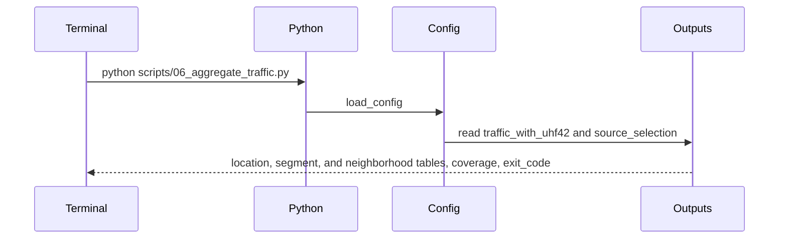

### merge-analysis

caller: Terminal, the command that starts the merge.
request: `python scripts/07_merge.py`. Arguments: none. Reads `cleaned_asthma.csv`, `traffic_uhf42_year.csv`, and `dataset_source_comparison.csv`.
handler: `merge_uhf_period` outer-joins on `uhf42_id` and `period`. Missing traffic stays null. Missing asthma stays null. It checks one row per neighborhood per period and at most 42 neighborhoods per period. It fills `n_matched` and `n_usable` on the comparison table and does not change `recommended_source`. Neighborhoods that fail the segment threshold, lack a rate, or lack traffic are kept in the merged file with `coverage_status=insufficient` and an `exclusion_reason`.
stages: Terminal, Python, Config, Outputs, Terminal.
response: `status` str, `exit_code` int, `message` str, `outputs/data/final_merged_dataset.csv` (table `final_merged`), updated `outputs/dataset_source_comparison.csv`, `outputs/quality/missing_data_report.csv` (table `missing_data_report`), `outputs/audit/exclusions_merge.csv`.
screen: On success the terminal prints the usable n for each period. When a period has usable n of 0, it prints that period and still exits 0. A duplicate key or a count above 42 exits 2 and writes no merged file.
diagram:

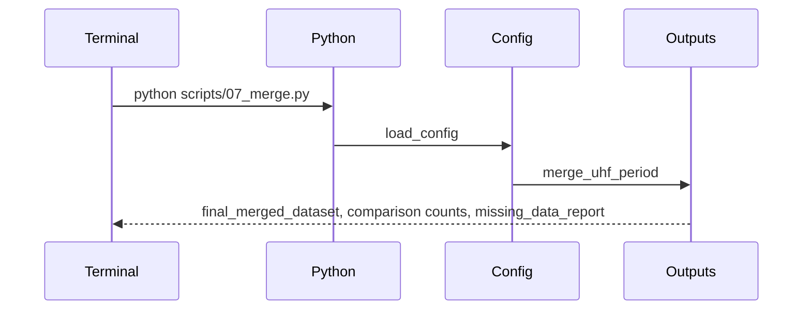

### describe-sample

caller: Terminal, the command that starts the sample description.
request: `python scripts/08_describe.py`. Arguments: none. Reads `final_merged_dataset.csv`, `traffic_uhf42_year.csv`, `traffic_monitoring_locations.geojson`, the local figure GeoJSON, and `source_selection.json`.
handler: `descriptive_tables` computes, for each period and for the whole usable sample, n, mean, median, standard deviation, minimum, maximum, range, Q1, Q3, IQR, and missing counts for the rate and the primary traffic mean, plus the distribution of `n_road_segments`. Borough and `coverage_status` get frequency, percentage, and mode. `sample_figures` writes S1 through S7 as PNG and PDF. S1 and S2 use the primary period chosen by the same rule as `test-hypotheses`, and they display n, mean, median, and standard deviation in the subtitle. S1–S7 have no p-values. S4 masks missing cells instead of drawing them as zero. S7 writes one map per included period.
stages: Terminal, Python, Config, Outputs, GeographyLocal, Outputs, Terminal.
response: `status` str, `exit_code` int, `message` str, `outputs/stats/descriptive_statistics_by_year.csv`, `outputs/stats/descriptive_statistics_by_borough.csv`, and the figure files named in Data model.
screen: On success the terminal prints each figure path and the primary period used for S1 and S2. When a figure has n of 0, the file is still written with an annotation that no eligible neighborhood is available. A missing merged file exits 2.
diagram:

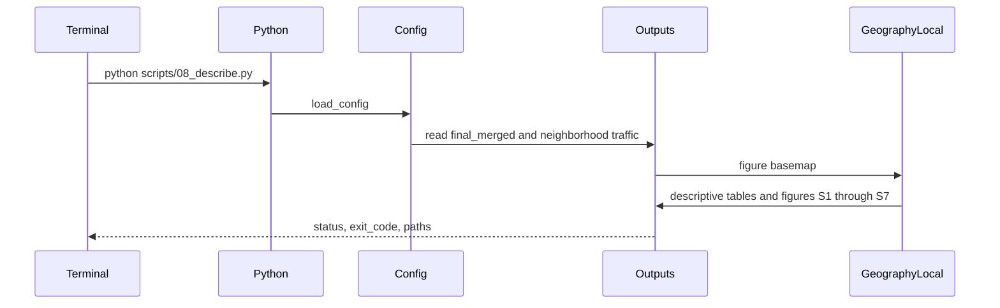

### test-hypotheses

caller: Terminal, the command that starts the tests.
request: `python scripts/09_test_hypotheses.py`. Arguments: none. Reads `final_merged_dataset.csv`, `traffic_location_year.parquet`, and config `years.primary_preference` (int), `stats.alpha` (float, 0.05), `thresholds.sensitivity_min_segments` (list of int), `thresholds.sensitivity_min_hours` (list of int), `stats.bootstrap_comparisons` (bool).
handler: A period whose usable n is below `min_uhf_per_period` is skipped with reason `below_min_uhf` and cannot become primary. The primary period is `primary_preference` when that period is included and its usable n is at least `min_uhf_per_period`. Otherwise it is the most recent included period that meets the threshold. The choice is recorded in `primary_reason` and does not look at p-values. `pearson_by_period` runs `scipy.stats.pearsonr` two-sided on usable rows, x = `traffic_mean_vehicles_per_hour`, y = `asthma_ed_rate_per_10000`, one test per included period. It records t = r * sqrt((n - 2) / (1 - r^2)) and df = n - 2, and the 95% interval from `confidence_interval`. SciPy supplies the p-value. A relative gap larger than 1e-4 between the formula t and SciPy's t exits 2. n below 3, zero variance, or |r| = 1 writes `test_status=skipped` and a null p-value. Holm adjustment is applied only to secondary periods with `test_status=ok`. `spearman_by_period` repeats the periods with Spearman's rank correlation. `sensitivity` reruns Pearson for leave-one-neighborhood-out on the primary period, for the stricter segment and hour thresholds, for the intersection of neighborhoods across included periods, and for the intersection of road segments, re-aggregated from `traffic_location_year.parquet`. `compare_periods` writes direction, magnitude, whether the interval contains 0, sample overlap, and `measurement_consistency`. It does not pool neighborhood-years into one Pearson test. Bootstrap comparisons run only when the flag is true, resampling neighborhoods while keeping each neighborhood's paired periods together.
stages: Terminal, Python, Config, Outputs, Terminal.
response: `status` str, `exit_code` int, `message` str, `outputs/stats/pearson_results_by_year.csv` (table `pearson_results`), `outputs/stats/spearman_results_by_year.csv` (table `spearman_results`), `outputs/stats/sensitivity_analysis_results.csv` (table `sensitivity_results`), `outputs/stats/correlation_comparison_results.csv` (table `correlation_comparison`).
screen: On success the terminal prints the primary period, r, the confidence interval, and the p-value, then one line per secondary period. When every period is skipped, it prints the skip reasons and exits 2. It does not print a fabricated p-value.
diagram:

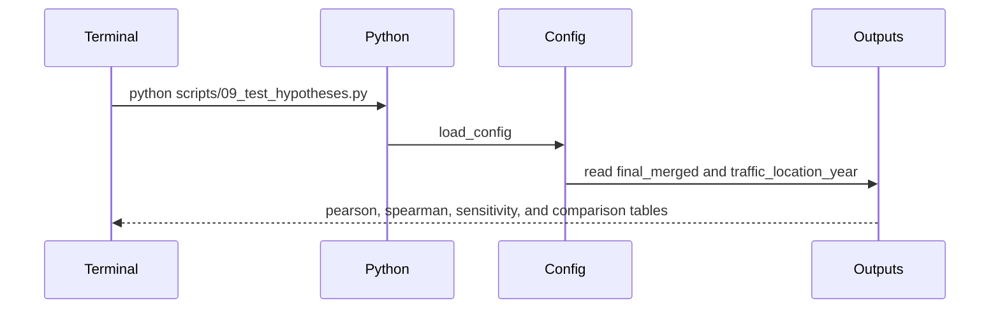

### write-report

caller: Terminal, the command that starts the report.
request: `python scripts/10_report.py`. Arguments: none. Reads the stat tables, the merged dataset, the comparison table, the exclusion logs, and `source_selection.json`.
handler: `result_figures` writes R1 for the primary period and R3 for every tested period, as PNG and PDF, with n, r, and the exact p-value on the statistical charts. R2 uses the most recent included period that is not the primary, on the same axis units as R1 when the ranges allow a shared scale. R4 plots Pearson and Spearman side by side and labels the test on each point. `workbook` writes the nine sheets listed in Data model. `compile_exclusions` concatenates the exclusion logs into `excluded_observations.csv`. `narratives` fills `results_summary.md` and `interpretation_guide.md` from the CSV values and a fixed sentence bank. The summary has four parts: the question and hypotheses; sources, sample size, variables, and descriptive statistics; the primary numbers without an explanation of why they arose; and the test justification with p-values and the file names of R1 and R3. The interpretation guide defines n, r, the p-value, the confidence interval, the directional reading, cross-period consistency, and the ecological limit, using the actual numbers. Neither file adds a causal claim or a literature comparison. This script does not rewrite `README.md`.
stages: Terminal, Python, Config, Outputs, Terminal.
response: `status` str, `exit_code` int, `message` str, figure files R1–R4, `outputs/research_results.xlsx`, `outputs/quality/excluded_observations.csv`, `outputs/results_summary.md`, `outputs/interpretation_guide.md`.
screen: On success the terminal prints the workbook path and the figure paths. When at least one Pearson row has `test_status=ok`, R1 and R3 exist. When only one period was tested, R2 is omitted and the summary says so, and the script still exits 0 because R1 and R3 are the two statistical graphs. When no test is ok, it writes the summary's limitation statement and exits 2.
diagram:

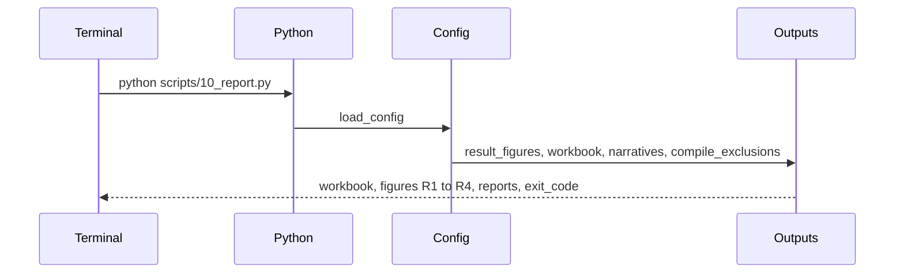

### run-tests

caller: Terminal, the pytest command.
request: `pytest`. Arguments: none. Reads `tests/fixtures/` only. It does not read `data/`, `outputs/`, or the network.
handler: pytest runs the invariant tests: pagination advances the offset by the rows in the page; a duplicate `:id` blocks compaction; an hour sum requires four distinct quarters and is the sum, not the mean, of those volumes; a segment with two locations receives one vote; the merge rejects a duplicate neighborhood-period key; an interior fixture point joins to one polygon; a pooled `TimePeriod` stays one period; a suppressed rate stays null; the primary-period function ignores a smaller p-value on an earlier year.
stages: Terminal, Python, Fixtures, Terminal.
response: `status` str, `exit_code` int, `message` str (pytest's summary line).
screen: On success the terminal shows the passed count and exits 0. A failed assertion names the invariant and exits non-zero. There is no empty-data state; the fixtures are part of the repository.
diagram:

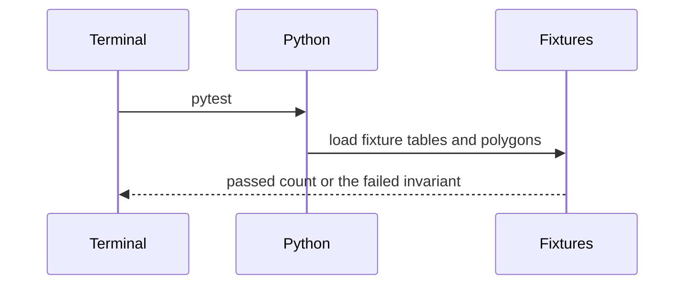

## System map

Nodes are the stages named in the route traces. Each edge label is a trace id. Follow the edges with one label in the order that trace lists its stages.

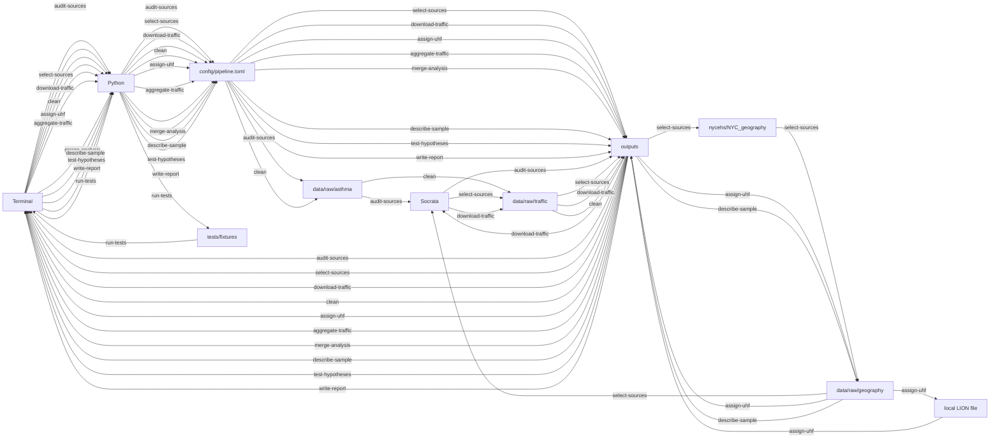

## Journeys

### Audit years and asthma periods

1. Screen: Terminal. The person places one asthma CSV or XLSX in `data/raw/asthma/` and runs the audit command.
2. Request: `python scripts/01_audit_sources.py`. Trace `audit-sources`.
3. Handler: `inventory_asthma` classifies `TimePeriod` labels. `fetch_schema` and `fetch_year_counts` record live fields and year counts. A year alias wins. Otherwise a configured date alias is counted with `date_extract_y`. A pooled label stays one period.
4. Tables: reads `config/pipeline.toml` and the asthma export; writes `asthma_time_periods` and `traffic_year_counts`. Invariant: every stored period id is the original label, and a label that spans several years has `period_kind=pooled`.
5. Response: status, exit code, and the audit paths.
6. Screen: the terminal lists period kinds and year counts. An empty export, a missing file, or a source with neither a year alias nor a date alias exits 2 with the path or the live columns. A network failure exits 1.

This journey uses `audit-sources`.

### Select the traffic source

1. Screen: Terminal. The person runs source selection after a successful audit.
2. Request: `python scripts/02_select_sources.py`. Trace `select-sources`.
3. Handler: `ensure_boundaries`, then `paginate` for the years the case logic needs, then `score_coverage` and `select_source`. The TOML thresholds are read and not written.
4. Tables: reads audit outputs and writes `source_selection`, `dataset_source_comparison`, and `coverage_for_selection`. Invariant: one recommended source per included period, AADT never combined with another source, and no gap filled by interpolation.
5. Response: status, exit code, scenario, and the selection paths.
6. Screen: the terminal prints the source for each period and the reason for each exclusion. Zero included periods exits 2. A bad boundary file or a broken page exits 2. A network failure exits 1.

This journey uses `select-sources`.

### Download the selected counts

1. Screen: Terminal. The person runs the download after a selection that includes at least one period.
2. Request: `python scripts/03_download_traffic.py`. Trace `download-traffic`.
3. Handler: `paginate` re-downloads each selected source-year, verifies `count(*)` and `:id` uniqueness, and compacts JSONL to Parquet.
4. Tables: reads `source_selection`; writes `records.parquet`, `manifest.json`, and `download_log`. Invariant: parquet row count equals the count query, and `:id` is unique within the year.
5. Response: status, exit code, and per-year counts.
6. Screen: matching counts are printed. A mismatch or duplicate `:id` exits 2 and leaves that year without `records.parquet`. HTTP failure exits 1.

This journey uses `download-traffic`.

### Clean asthma and traffic

1. Screen: Terminal. The person runs cleaning after the selected parquets exist.
2. Request: `python scripts/04_clean.py`. Trace `clean`.
3. Handler: `clean_asthma` then `clean_traffic`. Suppressed rates and missing counts stay null. Pooled labels are not expanded. Zero vehicle counts stay in the file.
4. Tables: reads the export and `records.parquet`; writes `cleaned_asthma`, `cleaned_traffic`, `cleaning_log`, and `exclusions_clean`. Invariant: one asthma row per `uhf42_id` and `period`.
5. Response: status, exit code, and row counts.
6. Screen: the terminal prints period counts and the number of duplicate rows removed. Zero asthma rows, a duplicate neighborhood-period, or an unexpected minute set exits 2.

This journey uses `clean`.

### Assign monitors to UHF42

1. Screen: Terminal. The person runs assignment after cleaning. They may set `geography.lion_path` before a retry when the audit reports boundary cases.
2. Request: `python scripts/05_assign_uhf42.py`. Trace `assign-uhf`.
3. Handler: `assign_points` joins monitoring locations to polygons. `resolve_non_interior` runs only for non-interior or borough-mismatched points, and only when a LION path is configured.
4. Tables: reads cleaned traffic and the local shapefile; writes `monitoring_locations`, `traffic_with_uhf42`, and `spatial_join_audit`. Invariant: each monitoring location has one `uhf42_id` or an exclusion reason, never two neighborhoods.
5. Response: status, exit code, and assignment counts.
6. Screen: the terminal prints assigned, unmatched, boundary, and mismatch counts. Non-interior points without a LION path exit 2. An id mismatch without a crosswalk exits 2. A coordinate range that is neither lon/lat nor EPSG:2263 exits 2.

This journey uses `assign-uhf`.

### Aggregate traffic to neighborhoods

1. Screen: Terminal. The person runs aggregation after assignment.
2. Request: `python scripts/06_aggregate_traffic.py`. Trace `aggregate-traffic`.
3. Handler: `complete_hours`, `location_years`, `segment_years`, `neighborhood_periods`. Each eligible road segment has one vote. Each year in a pool has one vote.
4. Tables: reads `traffic_with_uhf42`; writes `traffic_location_year`, `traffic_segment_year`, `traffic_uhf42_year`, and `traffic_coverage_by_uhf42`. Invariant: the neighborhood mean equals the unweighted mean of eligible segment means, and a pooled value equals the unweighted mean of year means.
5. Response: status, exit code, and eligible neighborhood counts.
6. Screen: the terminal prints those counts. A period with zero eligible neighborhoods is listed and the script still exits 0. An hour that cannot be built from the audited quarters exits 2.

This journey uses `aggregate-traffic`.

### Merge traffic with asthma

1. Screen: Terminal. The person runs the merge after aggregation.
2. Request: `python scripts/07_merge.py`. Trace `merge-analysis`.
3. Handler: `merge_uhf_period` joins on `uhf42_id` and `period`, keeps unmatched rows, and fills usable counts on the comparison table without changing the recommended source.
4. Tables: reads `cleaned_asthma` and `traffic_uhf42_year`; writes `final_merged` and `missing_data_report`. Invariant: unique (`uhf42_id`, `period`), at most 42 rows per period, nulls not replaced with zero.
5. Response: status, exit code, and usable n per period.
6. Screen: the terminal prints usable n. A period with usable n of 0 is printed and the script exits 0. A duplicate key exits 2.

This journey uses `merge-analysis`.

### Describe the sample

1. Screen: Terminal. The person runs the sample description after the merge.
2. Request: `python scripts/08_describe.py`. Trace `describe-sample`.
3. Handler: `descriptive_tables` and `sample_figures`. The charts are descriptive. They do not carry a p-value.
4. Tables: reads `final_merged`, neighborhood traffic, and the figure GeoJSON; writes the two descriptive CSV files and figures S1–S7. Invariant: S1 and S2 use the primary period from the primary-year rule.
5. Response: status, exit code, and figure paths.
6. Screen: the terminal prints the paths. A figure with n of 0 is written with a no-eligible-neighborhood annotation. A missing merged file exits 2.

This journey uses `describe-sample`.

### Test the correlation and compare periods

1. Screen: Terminal. The person runs the hypothesis script after the merge and the location-year file exist.
2. Request: `python scripts/09_test_hypotheses.py`. Trace `test-hypotheses`.
3. Handler: `pearson_by_period`, `spearman_by_period`, `sensitivity`, and `compare_periods`. The primary period follows the preference rule. Spearman and the sensitivity runs do not replace the primary Pearson row.
4. Tables: reads `final_merged` and `traffic_location_year`; writes the four stat tables. Invariant: one Pearson row per included period, raw p-values kept, Holm applied only to secondary tests, no pooled test that treats a neighborhood's years as independent.
5. Response: status, exit code, and the primary r, interval, and p-value.
6. Screen: the terminal prints the primary line and each secondary line. Skipped tests show a reason and a blank p-value. When every period is skipped, the script exits 2.

This journey uses `test-hypotheses`.

### Write the results packet

1. Screen: Terminal. The person runs the report after at least one successful Pearson test, then opens the workbook, the figures, and the two markdown files.
2. Request: `python scripts/10_report.py`. Trace `write-report`.
3. Handler: `result_figures`, `workbook`, `compile_exclusions`, and `narratives`.
4. Tables: reads the stat tables and exclusion logs; writes the workbook, R figures, `excluded_observations`, and the two reports. Invariant: every r and p in the markdown matches the Pearson CSV, and the summary's third section does not explain causes.
5. Response: status, exit code, workbook path, and figure paths.
6. Screen: the terminal prints those paths. R1 and R3 are present when a test is ok. A single tested period omits R2 and says so in the summary. Zero successful tests exit 2 after the limitation statement.

This journey uses `write-report`.

### Reproduce the study

1. Screen: Terminal. The person creates the virtualenv, installs `requirements.txt`, places the asthma export, and runs `./run_all.sh`.
2. Request: the shell runs, in order, the commands of `audit-sources`, `select-sources`, `download-traffic`, `clean`, `assign-uhf`, `aggregate-traffic`, `merge-analysis`, `describe-sample`, `test-hypotheses`, and `write-report`. The shell is a caller. It adds no operation.
3. Handler: each script's handler runs as in its own journey. A non-zero exit stops the shell.
4. Tables: the tables named in those ten traces, in that order. Invariant: a later script reads an earlier script's outputs and does not recompute a source decision.
5. Response: the last script's status, or the status of the script that stopped the shell.
6. Screen: the terminal shows each script's summary in order. A data-quality stop leaves the files of the failed script and does not run later scripts. The person reads `outputs/results_summary.md` when `write-report` exits 0.

This journey uses those ten traces.

### Check invariants

1. Screen: Terminal. The person runs pytest, with or without a data download.
2. Request: `pytest`. Trace `run-tests`.
3. Handler: pytest executes the nine invariant tests in the `run-tests` trace.
4. Tables: reads `tests/fixtures/` only. Invariant: a test does not write `outputs/` and does not call Socrata.
5. Response: pytest's exit code and summary line.
6. Screen: a passing run prints the passed count. A failure prints the invariant name.

This journey uses `run-tests`.

## Data model

### Period rule

`period` is the original `TimePeriod` string. A label with one four-digit year is `year` when that year is in `years.targets`, and it is dropped when that year is in `years.excluded`. A label with two four-digit years, separated by a hyphen, dash, or the word "to", is an inclusive range. The range is `pooled` when every year in it is a target year. If any year in the range is excluded, the whole label is dropped with reason `period_includes_excluded_year`. Any other label is dropped with reason `period_not_in_study`. The pipeline stores `constituent_years` and does not create asthma rows for the years inside a pooled label. Overlapping labels that would put the same neighborhood-year in two analysis periods stop cleaning with exit 2.

`uhf42_id` is a string, the numeric GeoID with leading zeros removed.

### Config keys

| key | type | default |
| --- | --- | --- |
| api.app_token | str | empty |
| api.page_size | int | 10000 |
| api.timeout_seconds | int | 120 |
| api.max_retries | int | 5 |
| api.retry_backoff_seconds | float | 2 |
| api.order_field | str | :id |
| api.user_agent | str | macaulay-seminar3-traffic-asthma |
| api.automated.base_url | str | https://data.cityofnewyork.us/resource/7ym2-wayt.json |
| api.historical.base_url | str | https://data.cityofnewyork.us/resource/btm5-ppia.json |
| api.aadt.base_url | str | https://data.ny.gov/resource/6amx-2pbv.json |
| years.targets | list of int | 2015, 2016, 2017, 2018, 2019, 2022, 2023 |
| years.excluded | list of int | 2020, 2021 |
| years.primary_preference | int | 2023 |
| thresholds.min_observation_dates | int | 2 |
| thresholds.min_complete_hours | int | 24 |
| thresholds.min_segments_per_uhf | int | 5 |
| thresholds.min_uhf_per_period | int | 30 |
| thresholds.sensitivity_min_segments | list of int | 5, 8, 10 |
| thresholds.sensitivity_min_hours | list of int | 24, 48 |
| thresholds.high_count_percentile | float | 99.9 |
| sources.mix_min_traffic_r | float | 0.8 |
| sources.aadt_xy_csv | str | empty |
| asthma.raw_dir | str | data/raw/asthma |
| geography.git_ref | str | master |
| geography.boundary_tolerance_meters | float | 1 |
| geography.coordinate_round_meters | float | 1 |
| geography.id_crosswalk_csv | str | empty |
| geography.lion_path | str | empty |
| pool.require_all_years | bool | true |
| stats.alpha | float | 0.05 |
| stats.bootstrap_comparisons | bool | false |

Field aliases are lists of strings. The first alias that appears in the live schema wins. Automated aliases include year `yr`, month `m`, day `d`, hour `hh`, minute `mm`, volume `vol`, segment `segmentid`, wkt `wktgeom`, direction `direction`, borough `boro`, request `requestid`. Historical and AADT alias lists are in the same TOML tables and are confirmed against `schema_snapshot.json`. AADT's year list also includes `aadt_year`. Historical's date list is `date`. In `fetch_year_counts` only, a live date alias is counted with `date_extract_y` when no year alias is present. An empty match stops the script that needed the field. A year count stops when the live keys contain neither a year alias nor that source's date alias.

Borough aliases map source tokens onto Manhattan, Bronx, Brooklyn, Queens, and Staten Island. An unknown token stops cleaning.

### cleaned_asthma

One row per neighborhood per asthma period. Columns: `uhf42_id` str, `uhf42_name` str, `borough` str, `period` str, `period_kind` str, `constituent_years` str, `asthma_ed_count` float or null, `asthma_ed_rate_per_10000` float or null. Invariant: unique (`uhf42_id`, `period`); null rates are not zero.

### cleaned_traffic

One row per kept source record. Columns include the source fields needed for audit, plus `source` str, `ts_local` timestamp, `vol` float, `monitoring_location_id` str, `hour_complete` bool, `high_count_flag` bool, `direction_normalized` str. Incomplete hours remain in the file with `hour_complete=false` so the exclusion is visible. The primary mean uses complete hours only.

### monitoring_locations

One row per `monitoring_location_id`. Columns: `monitoring_location_id` str, `road_segment_id` str or null, `uhf42_id` str or null, `assignment` str (`interior`, `lion_majority`, `outside_nyc`, `boundary`, `borough_mismatch`), `source_crs` str, geometry point. Invariant: one assignment per location.

### traffic_with_uhf42

Cleaned traffic rows that received a `uhf42_id`, plus `monitoring_location_id` and `road_segment_id`.

### traffic_location_year

One row per location per constituent year. Columns: ids, `year` int, `mean_hourly` float, `hour_balanced_mean` float, `n_complete_hours` int, `n_days` int, `n_sessions` int, `months` str, `weekday_hours` int, `weekend_hours` int, `eligible` bool, `exclusion_reason` str. `hour_balanced_mean` averages available clock-hour means, and averages weekday and weekend means when both exist. It is not the primary exposure.

### traffic_segment_year

One row per road segment per year per UHF. Columns: `road_segment_id` str, `uhf42_id` str, `year` int, `mean_hourly` float, `n_locations` int, `n_complete_hours` int, `n_days` int, `eligible` bool. Invariant: `mean_hourly` is the unweighted mean of that segment's eligible location means.

### traffic_uhf42_year

One row per neighborhood per analysis period. Columns: `uhf42_id` str, `period` str, `traffic_mean_vehicles_per_hour` float or null, `traffic_mean_hour_balanced` float or null, `traffic_median_vehicles_per_hour` float or null, `traffic_sd_vehicles_per_hour` float or null, `n_road_segments` int, `n_monitoring_locations` int, `n_observation_days` int, `n_complete_hours` int, `n_sessions` int, `months_represented` str, `weekday_weekend_coverage` str, `traffic_source` str, `coverage_status` str. Invariant: `traffic_mean_vehicles_per_hour` is the unweighted mean of eligible segment means. For a pooled period it is the unweighted mean of the year-level neighborhood means, and only neighborhoods eligible in every constituent year are `valid`.

### final_merged

One row per neighborhood per asthma period, including insufficient rows. Columns are the brief's analysis columns: `uhf42_id` str, `uhf42_name` str, `borough` str, `period` str, `asthma_ed_count` float or null, `asthma_ed_rate_per_10000` float or null, `traffic_mean_vehicles_per_hour` float or null, `traffic_median_vehicles_per_hour` float or null, `traffic_sd_vehicles_per_hour` float or null, `n_road_segments` int, `n_observation_days` int, `n_complete_hours` int, `traffic_source` str, `coverage_status` str (`valid` or `insufficient`), `exclusion_reason` str. `traffic_mean_hour_balanced` is also stored for the sensitivity test and is not the column Pearson reads. Invariant: unique (`uhf42_id`, `period`); at most 42 rows per period.

### Audit and quality tables

`asthma_time_periods`: `period` str, `period_kind` str, `constituent_years` str, `n_rows` int.

`traffic_year_counts`: `source` str, `year` int, `record_count` int, `schema_ok` bool.

`source_selection`: `scenario` str, `mix_used` bool, `comparability_pass` bool, `comparability_r` float or null, `comparability_n` int or null, and a `periods` list of `period`, `source`, `years`, `included` bool, `reason` str.

`dataset_source_comparison`: `period` str, `asthma_available` bool, `automated_available` bool, `historical_available` bool, `aadt_available` bool, `raw_record_count` int, `distinct_segments` int, `n_uhf_with_traffic` int, `n_uhf_with_asthma` int, `n_matched` int, `n_usable` int, `recommended_source` str. `select-sources` leaves `n_matched` and `n_usable` empty. `merge-analysis` fills them and does not change `recommended_source`.

`coverage_for_selection` and `traffic_coverage_by_uhf42`: `period` str, `uhf42_id` str, `n_eligible_segments` int, `n_locations` int, `n_complete_hours` int, `adequate` bool, `source` str.

`download_log`: `source` str, `year` int, `expected_count` int, `downloaded_count` int, `duplicate_ids` int, `parquet_sha256` str.

`exclusions` and `excluded_observations`: `stage` str, `key` str, `reason` str, `source` str.

`spatial_join_audit`: `monitoring_location_id` str, `assignment` str, `uhf42_id` str or null, `borough_traffic` str, `borough_polygon` str, `rule` str.

`missing_data_report`: `period` str, `uhf42_id` str, `missing_rate` bool, `missing_traffic` bool, `exclusion_reason` str.

`descriptive_statistics_by_year`: `period` str, `variable` str, `n` int, `mean` float, `median` float, `std` float, `min` float, `max` float, `range` float, `q1` float, `q3` float, `iqr` float, `n_missing` int, `pct_missing` float.

`descriptive_statistics_by_borough`: `period` str, `borough` str, `coverage_status` str, `n` int, `pct` float.

`pearson_results`: `period` str, `role` str (`primary` or `secondary`), `n` int, `r` float or null, `t` float or null, `df` int or null, `p_raw` float or null, `p_holm` float or null, `ci_low` float or null, `ci_high` float or null, `alpha` float, `p_below_alpha` bool, `sign` str, `primary_reason` str, `test_status` str, `skip_reason` str, `traffic_source` str.

`spearman_results`: `period` str, `n` int, `rho` float or null, `p_raw` float or null, `test_status` str, `skip_reason` str.

`sensitivity_results`: `analysis_id` str, `period` str, `n` int, `r` float or null, `p_raw` float or null, `note` str.

`correlation_comparison`: `period` str, `n` int, `r` float or null, `p_raw` float or null, `p_holm` float or null, `ci_low` float or null, `ci_high` float or null, `sign` str, `traffic_source` str, `n_segments_median` float, `measurement_consistency` str.

### Figures and workbook

Sample figures, PNG and PDF, under `outputs/figures/sample/`: `S1_traffic_distribution`, `S2_asthma_distribution`, `S3_coverage_by_period`, `S4_coverage_heatmap`, `S5_asthma_boxplots`, `S6_traffic_boxplots`, `S7_coverage_map_<period-slug>`.

Result figures, PNG and PDF, under `outputs/figures/results/`: `R1_primary_scatter`, `R2_comparison_scatter` when a second period exists, `R3_correlation_forest`, `R4_pearson_spearman`.

`outputs/research_results.xlsx` sheets, in order: Year and Source Coverage, Matched Dataset, Sample Characteristics, Descriptive Statistics, Pearson Correlations, Spearman Sensitivity, Correlation Comparisons, Missing Data and Exclusions, Data Dictionary. The dictionary rows are `file`, `column`, `type`, `meaning`, `units`, taken from the tables above.

### Primary exposure

For automated and historical counts, a complete hour is the sum of four distinct quarter-hour volumes. The location-day value is the mean of that day's complete hours. The location-year value is the mean of those days. The segment-year value is the mean of the segment's eligible locations. The neighborhood-year value is the mean of eligible segments. A pooled neighborhood value is the mean of those year values. The Pearson test reads that neighborhood value and the asthma rate per 10,000. The pipeline describes this as the mean of sampled complete hours, not as a complete annual average of every hour in the year.

## API catalog

| id | call | request | response | errors | caller | stages |
| --- | --- | --- | --- | --- | --- | --- |
| audit-sources | python scripts/01_audit_sources.py | no CLI args; config api urls, year lists, asthma.raw_dir, field aliases, historical date alias | status str, exit_code int, asthma_time_periods, traffic_year_counts, schema_snapshot.json | exit 2 missing export, empty export, unknown period, neither year alias nor date alias; exit 1 network | Terminal | Terminal, Python, Config, AsthmaExport, Socrata, Outputs, Terminal |
| select-sources | python scripts/02_select_sources.py | no CLI args; audit files plus thresholds, mix_min_traffic_r, geography, pool.require_all_years | status str, exit_code int, source_selection.json, dataset_source_comparison.csv, coverage_for_selection.csv | exit 2 no included period, bad shapefile, unresolved hours, bad page; exit 1 network | Terminal | Terminal, Python, Config, Outputs, GeographyRepo, GeographyLocal, Socrata, TrafficRaw, Outputs, Terminal |
| download-traffic | python scripts/03_download_traffic.py | no CLI args; source_selection.json, page_size, order :id, retries | status str, exit_code int, records.parquet, manifest.json, download_log.csv | exit 2 count mismatch, duplicate :id, checkpoint mismatch; exit 1 HTTP 4xx or retries exhausted | Terminal | Terminal, Python, Config, Outputs, Socrata, TrafficRaw, Outputs, Terminal |
| clean | python scripts/04_clean.py | no CLI args; asthma export, records.parquet, field aliases, high_count_percentile | status str, exit_code int, cleaned_asthma.csv, cleaned_traffic.parquet, cleaning_log.md, exclusions_clean.csv | exit 2 zero asthma rows, duplicate neighborhood-period, bad minutes, unmapped direction, missing parquet | Terminal | Terminal, Python, Config, AsthmaExport, TrafficRaw, Outputs, Terminal |
| assign-uhf | python scripts/05_assign_uhf42.py | no CLI args; cleaned traffic, local shapefile, optional crosswalk, optional lion_path, tolerances | status str, exit_code int, traffic_monitoring_locations.geojson, traffic_with_uhf42.parquet, spatial_join_audit.csv | exit 2 non-interior points without LION, id mismatch without crosswalk, unknown CRS, missing shapefile | Terminal | Terminal, Python, Config, Outputs, GeographyLocal, LION, Outputs, Terminal |
| aggregate-traffic | python scripts/06_aggregate_traffic.py | no CLI args; traffic_with_uhf42, thresholds, pool.require_all_years | status str, exit_code int, traffic_location_year.parquet, traffic_segment_year.parquet, traffic_uhf42_year.csv, traffic_coverage_by_uhf42.csv | exit 2 hour cannot be built; a period with zero eligible neighborhoods exits 0 | Terminal | Terminal, Python, Config, Outputs, Terminal |
| merge-analysis | python scripts/07_merge.py | no CLI args; cleaned_asthma, traffic_uhf42_year, comparison table | status str, exit_code int, final_merged_dataset.csv, missing_data_report.csv, updated n_matched and n_usable | exit 2 duplicate key or more than 42 rows in a period | Terminal | Terminal, Python, Config, Outputs, Terminal |
| describe-sample | python scripts/08_describe.py | no CLI args; final_merged, locations, figure GeoJSON | status str, exit_code int, two descriptive CSVs, figures S1–S7 png and pdf | exit 2 missing merged file; n of 0 writes an annotated figure and exits 0 | Terminal | Terminal, Python, Config, Outputs, GeographyLocal, Outputs, Terminal |
| test-hypotheses | python scripts/09_test_hypotheses.py | no CLI args; final_merged, traffic_location_year, alpha, sensitivity lists, bootstrap flag | status str, exit_code int, pearson, spearman, sensitivity, and comparison CSVs | exit 2 every period skipped, or formula t far from SciPy t; a single skipped period stays a row with a null p | Terminal | Terminal, Python, Config, Outputs, Terminal |
| write-report | python scripts/10_report.py | no CLI args; stat tables, exclusion logs, source_selection | status str, exit_code int, research_results.xlsx, R figures, excluded_observations.csv, results_summary.md, interpretation_guide.md | exit 2 when no Pearson test is ok; a missing R2 with one period exits 0 | Terminal | Terminal, Python, Config, Outputs, Terminal |
| run-tests | pytest | no CLI args; tests/fixtures only | status str, exit_code int, pytest summary | non-zero when an invariant assertion fails | Terminal | Terminal, Python, Fixtures, Terminal |

## Screen catalog

| screen | traces it calls |
| --- | --- |
| Terminal | audit-sources, select-sources, download-traffic, clean, assign-uhf, aggregate-traffic, merge-analysis, describe-sample, test-hypotheses, write-report, run-tests |

The workbook, the PNG and PDF figures, and the two markdown reports are files the person opens after `write-report`. They do not call an operation.

## Auth

None. The datasets are public. `api.app_token` is an optional Socrata token stored in the TOML. There are no accounts and no roles.

## Error and empty states

The person sees these on the terminal, and in the written tables when a script got far enough to write them.

- Asthma export missing, or more than one file in `data/raw/asthma/`: exit 2, the expected directory printed.
- Export with headers and zero rows: exit 2, status empty.
- `TimePeriod` that cannot be classified, or two labels that overlap: exit 2, the label printed. A pooled label is listed as one period.
- Socrata year count with neither a year alias nor that source's date alias, count query failed, page count mismatch, duplicate `:id`, or checkpoint mismatch: exit 2, the live columns or the year and both counts printed, no `records.parquet` for that year.
- HTTP 429 and 5xx: retried, then exit 1 if retries run out. Other 4xx: exit 1 with the URL.
- No period meets the coverage thresholds: scenario D, comparison table written, exit 2. Later scripts do not run under `run_all.sh`.
- Boundary file without 42 valid polygons, or ids that do not match asthma GeoIDs and no crosswalk: exit 2.
- Points outside a polygon, on a boundary, or in the wrong borough, with no LION path: exit 2, counts printed. With a LION path, majority length assigns one neighborhood or the point is excluded.
- Suppressed or missing asthma rates: kept null, listed in `missing_data_report`, omitted from Pearson.
- A period whose usable n is below 3, or whose traffic or rate has zero variance: a Pearson row with `test_status=skipped`, no p-value printed.
- No successful Pearson test: `write-report` states the limitation and exits 2.
- A descriptive chart with n of 0: the chart file exists and says no eligible neighborhood is available.

## Open decisions
